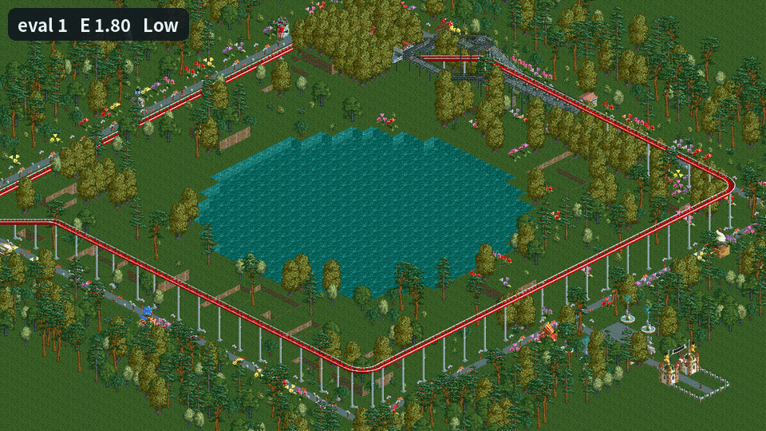
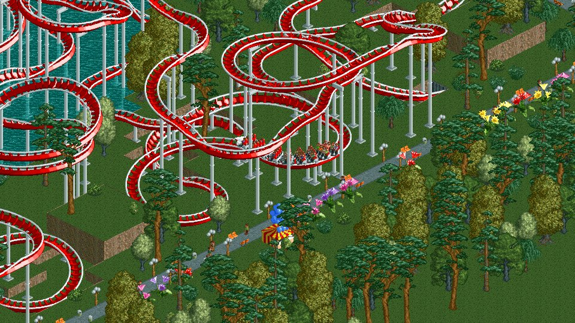
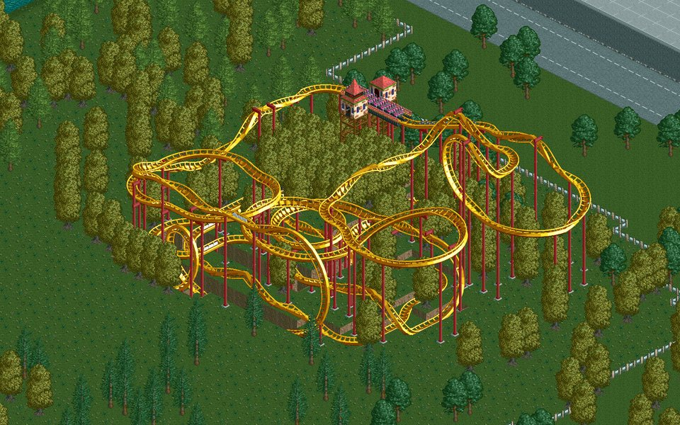
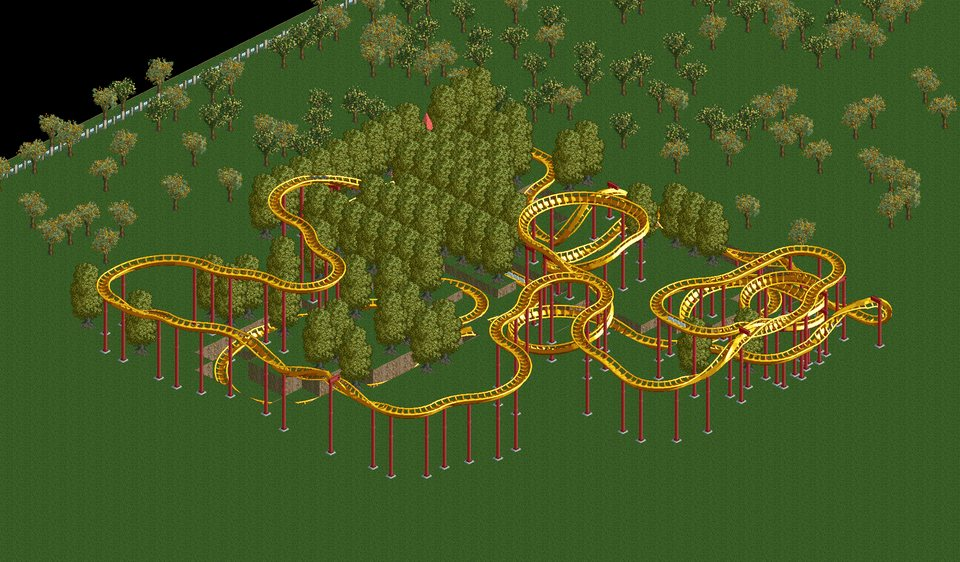
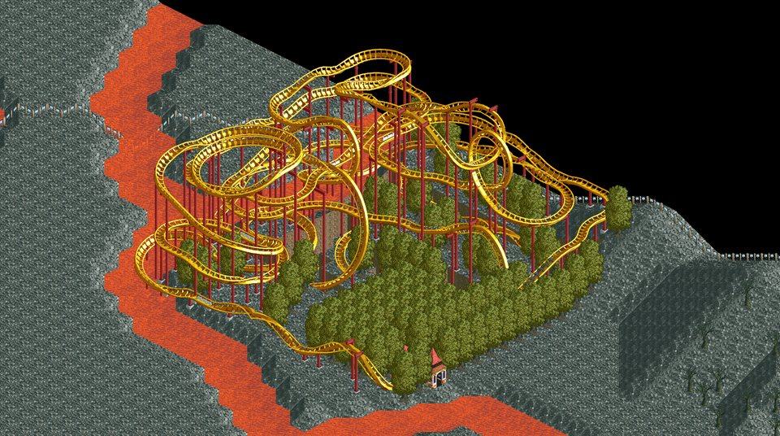
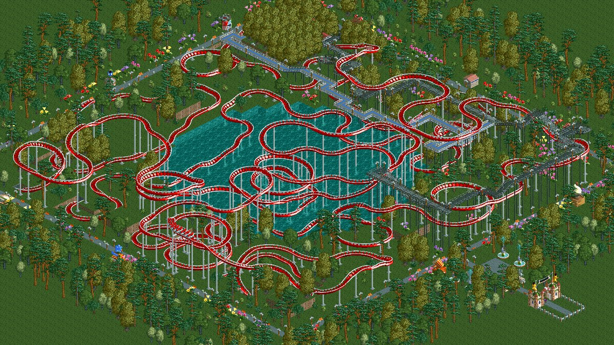

# rct2-close-the-loop

Roller coasters designed by search, with the real game as the judge. The search starts from the
simplest closed circuit, keeps it closed through every edit, and lets
[OpenRCT2](https://github.com/OpenRCT2/OpenRCT2) build, test-run and rate each candidate. Tens of
thousands of candidates are rated this way in one run.


<sub>The search, one frame per new best, from the first closed loop (evaluation 1) to the record
(evaluation 32,655). Each frame shows that track built in the finished park. E is the rating the
search got.</sub>

**Best coaster: a Hyper-Twister on a 40×40 lakeside area. It rates excitement 11.95, intensity
9.99 and nausea 8.75.** That is the game's *Extreme* band, which starts at 10.24. Rebuilt in the
decorated park above and tested again, it rates **12.06**. The search took 43,990 evaluations over
105 minutes. No rating cheats were used, and there are no synchronised departures; it is one coaster.

| Video | English | Korean |
| --- | --- | --- |
| The search, one picture per new best, from evaluation 1 to the record (83 s) | [search_en.mp4](results/video/search_en.mp4) | [search.mp4](results/video/search.mp4) |
| Ordinary guests arrive, queue, board and ride the finished coaster (52 s) | [ride_en.mp4](results/video/ride_en.mp4) | [ride.mp4](results/video/ride.mp4) |


<br><sub>A full train (36 guests) on the coaster, filmed in the running game for the ride video.</sub>

## How it works

1. **Close the loop first.** The search reads the land from the game, picks a station position,
   and fits the largest rectangle with a chain-lift hill that the area allows. Every candidate
   from here on is a complete circuit.
2. **Edit segments, never break the circuit.** An edit replaces a window of pieces with a short
   random walk plus an exact completion. The completion comes from a table of every sequence of
   up to four pieces, keyed by the displacement, direction, slope and bank it produces, so the new
   run ends exactly where the old one did. Over 58,406 phase 1 candidates, the game rejected none
   as an incomplete circuit.
3. **The game is the judge.** A plugin (`plugin/rct2loop.js`) receives the pieces over a local
   socket and creates the ride in a headless OpenRCT2. It adds the entrance and exit, plus the
   footpaths and trees the planner chose. It then runs a test lap at hyper speed and returns the
   game's own ratings. Fourteen instances in parallel rate about 19 tracks per second, or about
   7 when every candidate also gets its footpaths and trees (phase 3).
4. **Anneal.** Four annealing chains share the judges. The score is excitement minus a penalty
   past an intensity cap (and a nausea cap). A chain that stalls restarts from the first loop.
5. **Geometry mirrors the game.** `track.py` places pieces with OpenRCT2's track design rules,
   using segment data dumped from the game (`data/track_segments.json`). This lets it reject
   out-of-area, overlapping or underwater track before the game sees it. The game still has the
   final word.

Every evaluation is logged as one row of `runs/<run>/evals.jsonl`: the track before the edit, the
edit, the track after it, the verdict and the score.

## Results

The project ran in three phases. Each phase's goal and verdict are in [docs/GOAL.md](docs/GOAL.md).

| Phase | Goal | Result |
| --- | --- | --- |
| 1 | *Very High* coaster (E ≥ 7.68, I < 7.68, N < 5.12) in an empty 24×24 area | Giga Coaster **E 8.18 / I 5.92 / N 4.24**, the same in three fresh instances (`results/giga_final/`) |
| 2 | A general algorithm: a park file and any set of tiles in, a coaster out, with one fixed configuration and 15 minutes per condition, measured on held-out conditions | **15/20 held-out conditions**: 9/10 real RCT2 scenario maps and 6/10 random terrains. The pre-set bar was 80%. A second held-out set after two bug fixes: **5/6** (`results/gallery/`) |
| 3 | One coaster in the *Extreme* band (E ≥ 10.24) | Hyper-Twister **E 11.95**, 12.06 in the decorated park (`results/extreme/best40/`, `results/showcase/lakeside/`) |

Phase 2 respects the land as it is. Track stays on owned land or land with construction rights,
never goes under water, and keeps clear of existing scenery, paths and rides. It may lower land
for trenches and tunnels; the land is restored after each evaluation.

<p>



</p>
<sub>Phase 2 coasters on held-out windows of real scenario maps (E 8.51, 8.46, 8.43). Each one's
park file sits next to its pictures, ready to open in OpenRCT2.</sub>


<sub>The record coaster in the decorated park: promenade, stalls, gardens and a park entrance
around the design's own exit path, queue and trees. Tested again there, it rates E 12.06.</sub>

Phase 3, every result re-rated in a fresh instance:

| Area | Coaster | E / I / N | |
| --- | --- | --- | --- |
| 40×40 flat, dug lake and mounds | Hyper-Twister | **11.95** / 9.99 / 8.75 | `best40`: 45 min plus a 60 min continuation |
| 40×40, same land | Hyper-Twister, trains reversed | 11.71 / 8.46 / 7.96 | `land40` (11.58 forward) |
| 40×40 | Giga Coaster | 10.61 / 9.06 / 7.83 | `giga40` |
| 32×32 flat | Hyper-Twister, trains reversed | 11.00 / 10.02 / 9.07 | `final32` (10.89 forward) |
| 24×24 flat | Hyper-Twister | 10.94 / 9.43 / 7.70 | `final24` |
| Alpine Adventures (real scenario map), 40×40 | Hyper-Twister, alpine colours and trees | 11.13 / 10.30 / 8.31 | `alpine40` |
| Same, no piece above about 10 m | Hyper-Twister | 10.53 / 9.85 / 7.83 | `alpine40_low` |

The sizes of the individual levers are measured in [docs/LOG.md](docs/LOG.md) and explained from
the rating code in [docs/RATINGS.md](docs/RATINGS.md). The biggest were real footpaths that touch
the track (about +1.2), the vehicle (about +0.5), and an intensity cap just under the game's 10.00
penalty (about +0.4).

### What the search may and may not do

- **Ratings come only from the game.** Only a `TESTING` lap produces them, and it needs an
  entrance and an exit.
- **No rating cheats.** The search never uses "enable all drawable track pieces", vehicles from
  other track types, disabled clearance checks or synchronised departures. Allowed pieces come
  from each ride type's own track groups (`data/track_groups_rtd.json`).
- **Only real paths count.** The planner builds an exit path out to the edge of the area and a
  queue line that joins it, as one connected network. Loose path tiles placed only to farm
  proximity points are not used.
- **Housekeeping cheats only.** Evaluation instances build while paused and run with no money,
  research ignored and breakdowns off. Guests are removed, and the objective is set to "Have fun"
  so the scenario never ends and resets the speed. None of these touch the ratings.
- **Trees and paths are part of the score.** The game rewards scenery near the station, scenery
  beside the track and paths that touch the track. Without paths, the same phase 3 setup reaches
  about 9.4 to 9.5.

## Repository

```
plugin/rct2loop.js            OpenRCT2 plugin: build, test, rate, scan land, film (JSON lines over TCP)
src/rct2_close_the_loop/
  track.py                    piece geometry (OpenRCT2's track design rules), circuit closure, space checks
  edits.py                    circuit-preserving segment edits
  search.py                   annealing, run logs, scoring
  game.py, judge.py           headless instances, judge pool (restarts, timeouts)
  env.py, site.py             land scan from the game; station placement and the first loop
  design.py                   the general pipeline and its configurations (FIXED, EXTREME), land shaping
  paths.py, decor.py          exit path and queue planner; tree planting plan
  theme.py                    colours, trees and paths matched to the surrounding park
  bench.py                    benchmark conditions (random terrains, windows of real scenario maps)
  layouts.py                  ride bases and the flat 24×24 layouts
  results.py                  saved parks, screenshots, evolution animations
  analysis.py, report.py      run summaries
scripts/                      benchmark, gallery, rendering, showcase, videos, data extraction
data/                         segment geometry, track groups, clearances, rating tables, conditions, parks
results/                      parks, screenshots, summaries, videos
docs/                         GOAL.md (goals and verdicts), LOG.md (lab notebook), RATINGS.md (rating rules), in Korean
```

## Setup

This needs Linux x86_64 (developed on Ubuntu 26.04), [uv](https://docs.astral.sh/uv/), and
*RollerCoaster Tycoon 2: Triple Thrill Pack* installed through Steam. RCT2 supplies the game data,
which this repository does not include.

```bash
./scripts/setup_env.sh        # idempotent; RCT2_PATH=/path/to/rct2 if it is not in the default Steam folder
uv run python scripts/smoke_test.py
```

The setup script does the following:

- Downloads OpenRCT2 v0.5.6 into `.vendor/`, adding `libzip5` next to it if the system lacks it.
- Points `~/.config/OpenRCT2/config.ini` at the game data. The CLI screenshot command reads that
  file; it also gets local-only hosting and debugging tools.
- Runs `uv sync` and `pyrct2 setup`.

Evaluation instances use their own user folder (`runtime/`), so your own OpenRCT2 settings are
left alone. The videos also need `ffmpeg`, `Xvfb` and the Noto Sans CJK font.

## Usage

```bash
# Phase 1: annealing on a flat 24x24 area
uv run rct2loop search --layout giga_24 --hill 8 --minutes 25
uv run rct2loop evaluate runs/<run>/best.json --layout giga_24      # re-rate in a fresh instance
uv run rct2loop render runs/<run>/best.json NAME --layout giga_24   # results/NAME/: park + screenshots

# Phase 2: the general pipeline on one condition, or a whole benchmark split
uv run rct2loop design data/bench/dev/syn101.json --seed 1
./scripts/run_bench.sh dev 1
uv run python scripts/summarize_bench.py dev runs/*/    # results/benchmark_dev.json
uv run python scripts/gallery.py dev runs/*/            # results/gallery/: parks, screenshots, ratings without trees

# Phase 3: the record run, then its continuation
uv run rct2loop design data/extreme/flat40.json --config extreme --ride hypertwister \
  --set station_len=5 --set i_cap_start=10.3 --set i_cap_end=10.3 --set paths='"v2"' \
  --set lake=0.25 --set mounds=8 --set tunnels=true --minutes 45
uv run rct2loop continue runs/<run> --minutes 60
uv run python scripts/render_best.py runs/<run> NAME   # results/extreme/NAME/ (--reversed for reversed trains)

# The decorated park and the videos
uv run python scripts/showcase.py results/extreme/best40/best40.park results/showcase/lakeside
uv run python scripts/make_videos.py search en   # results/video/search_en.mp4
uv run python scripts/make_videos.py ride en     # films a running game, then edits results/video/ride_en.mp4
uv run python scripts/make_videos.py readme      # docs/media/: the GIF above and the stills
```

- **Conditions.** A condition (`data/bench/<split>/*.json`, `data/extreme/*.json`) is a park plus
  a set of tiles. A real-map condition names a scenario, which is loaded from your RCT2 install.
- **Run folders.** `runs/` is not committed. The search video's inputs (every new best of the
  record run and the run's settings) are kept in `results/video/search_records.json`.
- **Data tools.** `scripts/extract_track_groups.py`, `extract_rating_tables.py`,
  `measure_clearance.py` and `ride_objects.py` regenerate the tables in `data/`.
  `rating_model.py` compares ride types on the same statistics using those tables.

## Notes

- **Speed.** The game runs at speed 8 (hyper), about 4,800 ticks per second, which needs
  `debugging_tools = true`. The plugin keeps the speed at 8 on every evaluation, because a
  finished scenario drops it back to 1.
- **Stalls.** A train that cannot clear a hill rolls back and forth. The test is stopped once the
  lead car has reached no new track for 1,500 ticks.
- **Screenshots and saving.** A headless game crashes if it captures an image, so parks are saved
  and rendered with the CLI `screenshot` command instead. The ride video is filmed in a game with
  a renderer on a virtual display. In host mode, saving only works inside a custom game action.
- **Determinism.** The same track gets the same ratings in any instance, whatever that instance
  did before. Raw statistics such as air time and tick counts can still vary slightly.

## Acknowledgements

The project is built on [OpenRCT2](https://github.com/OpenRCT2/OpenRCT2) and
[pyrct2](https://pypi.org/project/pyrct2/). The video music is a pair of public-domain recordings
from OpenRCT2's OpenMusic: *Dill Pickles Rag* (Charles L. Johnson, 1906) and *El Capitan* (John
Philip Sousa, 1896).

## License

The code is released under the [MIT License](LICENSE). The screenshots, videos and park files
show RollerCoaster Tycoon 2 graphics and scenario maps, which belong to their owners and are not
covered by that licence. The music in the videos is in the public domain.
